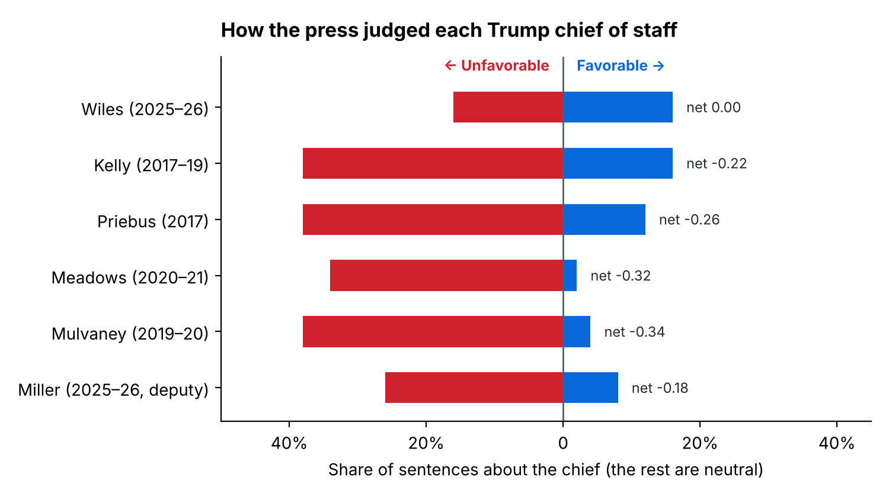

# How the press judged Trump's chiefs of staff

Stephen Miller becomes White House chief of staff on November 9, 2026, replacing Susie Wiles. This project asks a narrow question about the job he is taking over: **while each of Trump's chiefs of staff held the job, did news coverage portray them favorably or unfavorably?**

## Finding

**Susie Wiles is the only Trump chief of staff the press treated evenly. Each of the four first-term chiefs (Reince Priebus, John Kelly, Mick Mulvaney and Mark Meadows) was portrayed unfavorably far more often than favorably: 34–38% of sentences about them were unfavorable, against 2–16% favorable.** That includes Kelly, often remembered as "the adult in the room."



| Chief | Favorable | Unfavorable | Net (95% range) |
|---|---|---|---|
| Susie Wiles (2025–26) | 16% | 16% | 0.00 (−0.16 to +0.16) |
| John Kelly (2017–19) | 16% | 38% | −0.22 (−0.40 to −0.02) |
| Reince Priebus (2017) | 12% | 38% | −0.26 (−0.44 to −0.08) |
| Mark Meadows (2020–21) | 2% | 34% | −0.32 (−0.46 to −0.18) |
| Mick Mulvaney (2019–20) | 4% | 38% | −0.34 (−0.50 to −0.18) |
| Stephen Miller (2025–26, as deputy) | 8% | 26% | −0.18 (−0.34 to −0.02) |

The remaining sentences were neutral. **Net** is the favorable share minus the unfavorable share, so it runs from −1 (every sentence unfavorable) to +1 (every sentence favorable).

- **Wiles stands apart.** Her net score is 0.29 higher than the average of the four first-term chiefs (95% range +0.11 to +0.47).
- **The first-term chiefs can't be told apart.** Their scores fall between −0.22 and −0.34, and their ranges overlap almost entirely.
- **Miller has not been chief yet.** His row covers his time as deputy chief of staff, for comparison.

## Method

**1. Outlets.** CNN, NBC News and the Washington Examiner. These three publish complete, dated lists of their articles (sitemaps) back to 2017 and allow downloads, so every chief is measured against the same outlets. Two lean center-left and one leans right.

**2. Articles.** Every article published during a chief's tenure whose web address names the chief or mentions "chief of staff," and whose text names the chief in full and discusses them in at least two sentences. Each article is dated by the sitemap it was listed in. Result: 591 articles.

**3. Sentences.** From each article, up to eight sentences that mention the chief. Sentences where the chief is the one speaking ("Kelly said…") are dropped, because they show what the chief said, not how the press portrayed them. Result: 2,108 sentences.

**4. Hand coding.** 50 sentences per chief, drawn at random (300 in all), with the chief's name replaced by "[CHIEF]". Each sentence is coded favorable (+1), unfavorable (−1) or neutral (0) using the rules in [CODEBOOK.md](CODEBOOK.md). The question is how the sentence portrays the person, not whether the news around them is good or bad.

**5. Scoring.** For each chief, the shares of favorable and unfavorable sentences, and net = favorable − unfavorable. The 95% ranges come from resampling the 50 sentences 10,000 times.

## Limits

- **One coder so far.** The 300 sentences were coded by Claude, an AI model. An independent human coder should code the same sentences before these numbers are cited. [`data/second_coder_sheet.csv`](data/second_coder_sheet.csv) is the blank sheet (about an hour of work). Save the results as `data/second_coder_labels.csv` (columns `id,label`), and step 4 will report how often the two coders agree.
- **Small samples.** 50 sentences per chief gives ranges of about ±0.17, enough to separate Wiles from the first-term chiefs but not the first-term chiefs from each other.
- **Three outlets, one on the right.** Fox News, the New York Post, the Washington Times and National Review either block access or publish no dated archive.
- **Name matching only.** Sentences that refer to a chief only as "he" or "the chief of staff" are not included.

## Files

| Path | What it is |
|---|---|
| `data/coded_sample.csv` | The 300 hand-coded sentences, with source, date, masked text and label |
| `data/results.csv` | The numbers in the table above |
| `data/articles.csv`, `data/sentences.csv` | The full corpus the sample was drawn from |
| `data/candidates.csv` | Every in-tenure URL checked in step 1 |
| `data/second_coder_sheet.csv` | Blank coding sheet for an independent coder |
| `CODEBOOK.md` | Coding rules |
| `scripts/` | The four steps below |

## Reproduce

```bash
pip install -r requirements.txt
cd scripts
python 1_collect.py    # read sitemaps, download articles (about an hour the first time; cached in cache/)
python 2_extract.py    # keep articles and sentences about each chief
python 3_sample.py     # draw the 50-per-chief sample (keeps existing codes; tops up if needed)
python 4_analyze.py    # results table and chart
```

Only step 4 is needed to reproduce the results from the committed data. Rerunning steps 1–3 downloads live web pages, which can change over time. `3_sample.py` keeps every coded sentence that is still in the corpus and draws new ones to fill any gaps, which then need labels.
