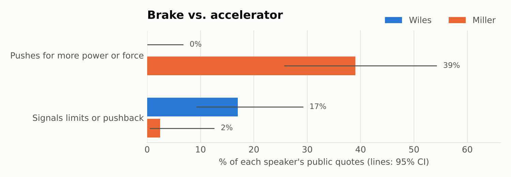

# From brake to accelerator

Stephen Miller replaces Susie Wiles as White House Chief of Staff on November 9, 2026. Miller's immigration agenda was already White House policy, so this repo asks what else changes. It analyzes both people's public statements.

**Finding:** Wiles talks like a brake: she describes limits on Trump, disagreements, and times she was overruled. Miller talks like an accelerator: he pushes for more power, force and enforcement. The policy direction stays the same; the internal friction goes away.



**→ [Read the report](reports/REPORT.md)** (one page) · [Supporting analyses](reports/supporting-analyses.md)

## What's here

| Path | Contents |
|---|---|
| `reports/REPORT.md` | The main write-up |
| `reports/supporting-analyses.md` | Vocabulary, Miller's testimony, how others describe them, ideology scores |
| `data/utterances.jsonl` | 99 public quotes (55 Wiles, 44 Miller), each with date, venue, source link and codes |
| `data/perceptions.jsonl` | 43 descriptions of the two by allies, critics and reporters |
| `data/miller_deposition_2022.jsonl` | Miller's answers from his Jan. 6 Committee deposition |
| `docs/CODEBOOK.md` | How each quote was coded, including brake / accelerator |
| `docs/METHODOLOGY.md` | Sources, measures, statistics and limitations |
| `src/mvw/` | Analysis code |
| `collect/` | Scripts that gathered and parsed the source material |

## Reproduce

```bash
pip install pandas numpy scipy scikit-learn vaderSentiment matplotlib pyyaml pytest
python run.py   # writes reports/results.json and the figures (~3 min)
pytest -q
```

The ideology-score model (`src/mvw/ideal_points.py`) needs a separate download of congressional tweets; its docstring has the steps.

## Limits

The quote sample is small and comes mostly from news coverage, so it reflects what journalists chose to quote. Wiles rarely speaks publicly, and most of her "brake" quotes come from one series of Vanity Fair interviews. One coder (an AI model) assigned the codes. Every quote links to its source; check the wording there before citing it.
