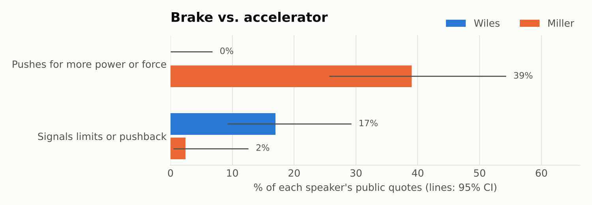
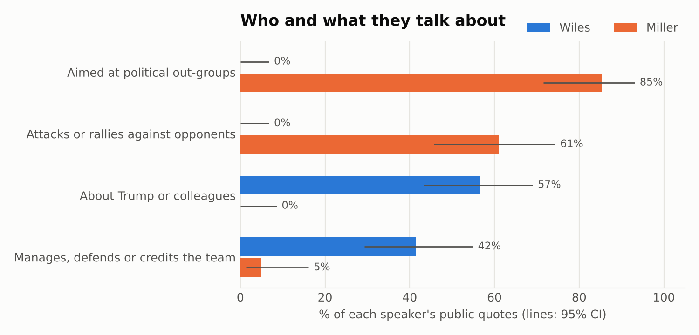

# From brake to accelerator: what Stephen Miller's promotion changes

*November 7, 2026*

On Monday, Stephen Miller replaces Susie Wiles as White House Chief of Staff. Miller is best known as the architect of the administration's immigration crackdown, and Wiles as the low-profile operator who co-managed Trump’s 2024 campaign.

You might expect the change to move policy to the right. It mostly won't. Miller has run immigration and homeland security policy from the deputy chief of staff's office since January 2025. His agenda is already the White House's agenda.

**What changes is the job at the top of the staff.** Across their public statements, Wiles talks like a brake: she describes limits, disagreements, and times she lost. Miller talks like an accelerator: he pushes for more power, more force, more enforcement. As chief of staff, Miller will control the flow of people, paper and decisions to the president. The person most likely to push the pedal now also controls who can reach the brake.

**How to read the chart:** we coded every public quote we could find from each person, 53 for Wiles and 41 for Miller, from February 2024 to November 2026.
- **Miller:** 16 of his 41 quotes (39%) push for more executive power, force or enforcement. One quote (a walk-back after a fatal shooting) signals restraint.
- **Wiles:** none of her quotes push for more power. 9 of 53 (17%) signal limits on Trump or pushback against a policy.

## In their own words

| | Wiles | Miller |
|---|---|---|
| **The limits of presidential power** | Trump believes there's "nothing he can't do. Nothing, zero, nothing." | "Under Title 10 of the U.S. Code, the president has plenary authority." |
| **Going after opponents** | A "loose agreement that the score settling will end before the first 90 days are over." | Left-wing groups: "identify, disrupt, dismantle, and destroy." |
| **Policy** | "There have been a couple of times where I've been outvoted." On tariffs: "It's been more painful than I expected." | "A minimum of 3,000 arrests for ICE every day… keep pushing to get that number up higher each and every day." |
| **Force abroad** | On boat strikes: "He wants to keep on blowing boats up until Maduro cries uncle." | "We live in a world… governed by strength… governed by force… governed by power." |
| **Same event: Charlie Kirk's memorial** | "That was Charlie's army, and he made sure they understood what was at stake." | "You are nothing. You are wickedness, you are jealousy, you are envy, you are hatred." |

The pattern also shows in how the White House actually worked. When Miller pushed in 2025 to suspend habeas corpus for migrants (he told reporters the White House was "actively looking at" it), the White House staff secretary's memo warning that only Congress can do that went to Wiles (*New York Times*, June 2026).

## Who and what they talk about

- **Wiles** talks about the inside of the building. Most of her quotes are about Trump or colleagues, and many manage staff, defend the team, or give credit. In our sample she never attacks a political opponent; her only adversary is the press.
- **Miller** talks about the outside. 85% of his quotes are aimed at Democrats, protesters, immigrants, courts or foreign governments, and most attack or rally against them.

## How sure are we?

- **Miller's accelerator pattern is solid.** It appears across TV interviews, social posts, speeches and remarks to reporters.
- **Wiles's brake pattern is thinner.** Almost all of it comes from one source: a series of 11 recorded interviews she gave Vanity Fair (December 2025). She rarely speaks publicly, so there isn't much else. Third-party reporting points the same way, for example her reported worry that Trump was getting "a rose-colored view" of the Iran war.
- **A brake isn't proof of braking.** Trump issued the Jan. 6 pardons and the tariffs over her reservations, and she said herself, "if there's a tie, he wins." So the change may matter less than the contrast suggests. A weak brake is still more friction than none.
- **The sample is small and filtered by the press.** These are the quotes journalists chose to report: Miller's most combative lines and Wiles's most candid ones. Each quote links to its source, and one coder (an AI model) assigned the brake/accelerator codes.
- **Miller can sound different.** In his 2022 Jan. 6 Committee testimony he is careful and hedged, with no combative language. His public voice is a choice he makes.

## What to watch after Monday

1. **Pushback signals:** do leaked or on-record signs of internal restraint from the chief of staff's office disappear?
2. **Visibility:** does the chief of staff become a public figure, posting and appearing on TV in a way Wiles never did?
3. **Register:** does the chief of staff's job pull Miller toward management talk, or does he stay in attack mode?
4. **Pace:** do executive actions speed up, and do court losses rise with them?

---

*Data, code and coding rules: see the [README](../README.md). Additional analyses (vocabulary, his testimony, how others describe them, and why standard left–right ideology scores can't separate them) are in [supporting-analyses.md](supporting-analyses.md).*
