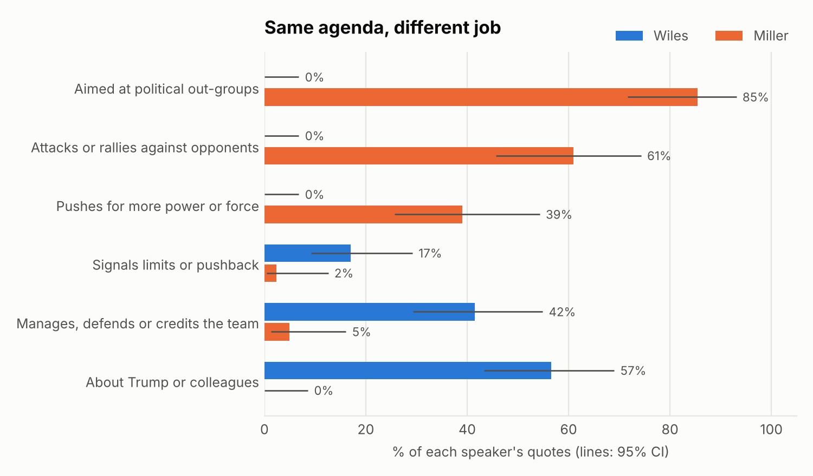

# Wiles vs. Miller: same agenda, different friction

*Stephen Miller replaces Susie Wiles as White House Chief of Staff on Nov 9, 2026.
This report compares them from 99 attributed public quotes (55 Wiles, 44 Miller), 43 descriptions of
them by others, and Miller's 450-answer Jan. 6 Committee deposition.*

## The short answer

The easy take is that Miller is the hardliner and Wiles the quiet operator. The data supports the first half: on immigration, executive power and treating opponents as enemies, Miller is far out. But that isn't what changes on Nov 9. **Miller's agenda was already White House policy**: he ran immigration and homeland security as deputy chief of staff under Wiles.

What changes is **the job being done at the top of the staff**. Wiles's public words are about running the building: managing staff, defending the team, and (on the record) pushing back on Trump. Miller's are about fighting opponents and expanding power. **The agenda doesn't change; the internal friction does.** The person who most often pushed for more power and force now also controls what reaches the president.

## Four findings, rated by strength of evidence

| # | Finding | Evidence | Why that rating |
|---|---|---|---|
| 1 | **Different job.** Wiles points inward (Trump, staff, colleagues); Miller points outward (opponents, immigrants, courts, foreign states). | **Strong** | Very large gaps (0% vs 85% aimed at political out-groups) that survive dropping Wiles's biggest source |
| 2 | **Wiles brakes, Miller accelerates.** 17% of Wiles's quotes signal limits or pushback, against 2% of Miller's. 39% of Miller's push for more power or force, against 0% of Wiles's. | **Moderate for Miller, weak for Wiles** | Miller's accelerator pattern appears across venues. *Every* Wiles brake quote comes from one source (Vanity Fair), backed by third-party reports, and whether her brake actually worked is unproven |
| 3 | **Miller's public voice is partly a chosen register.** Under oath he sounds much more like Wiles. | **Moderate** | Strong contrast, but the deposition is from 2022 and in a legal setting |
| 4 | **Standard ideology scores can't separate them**, because those scores miss what makes Miller distinctive. | **Methodological** | The old left–right scale measures economics and the role of government, not immigration, nationalism or executive power (§5) |

---

## 1. Job: inward manager vs. outward combatant

- **Wiles:** 57% of her quotes are about Trump or colleagues, and 42% manage, defend or credit the team. *None* attack anyone, assert power, or target an out-group. Her only adversary is the press. Without Vanity Fair, the pattern holds: still zero attack or power quotes.
- **Miller:** 85% of his quotes are aimed at political out-groups (opposition 46%, immigrants 17%, foreign states 12%, courts 10%), and 61% attack or rally against opponents.

**Vocabulary** (per 100 words, FDR-corrected): threat words 0.0 vs 5.4, power words 0.0 vs 5.0, management words 4.4 vs 0.4. Wiles says "I" at 7.0 per 100 words, Miller at 0.8. Wiles speaks as an individual reporting on her boss; Miller speaks as "we" against "you" and "they."

## 2. Friction: who brakes, who accelerates

**Miller, accelerator (39% of quotes), across venues:**
- habeas corpus suspension "actively looking at"
- the president "has plenary authority"
- a "minimum of 3,000 arrests for ICE every day"
- "identify, disrupt, dismantle, and destroy"
- the world is "governed by strength… force… power"
- "The president was clear: green light"

**Wiles, brake (17% of quotes), all from her Vanity Fair interviews:**
- a "loose agreement that the score settling will end before the first 90 days are over"
- "a couple of times where I've been outvoted"
- tariffs "more painful than I expected"
- "there is no evidence" for Trump's Clinton–Epstein claim
- "aghast" at the dismantling of USAID

**Third-party reports point the same way.** Wiles worried that Trump was getting "a rose-colored view" of the Iran war (Time). When Miller pushed to suspend habeas corpus, the White House lawyer's memo warning that only Congress can do that went to **Wiles** (NYT, June 2026).

**The counterpoint, which matters:** Trump did the Jan. 6 pardons and the tariffs anyway, and Wiles herself said "if there's a tie, he wins." Her brake signals also come from a profile she may have given partly to shape her legacy. **The case that she *was positioned* as a brake is decent. The case that the brake *worked* is weak.** If it rarely worked, the practical change on Nov 9 is smaller than the rhetorical gap suggests.

## 3. Register: Miller under oath

| per 100 words | Miller in public | Miller under oath (26,306 words) | Wiles in public |
|---|---|---|---|
| "I / me / my" | 0.6 | **6.7** | 7.0 |
| Hedging | 0.4 | 1.2 | 2.0 |
| Threat / power words | 10.4 | **0.0** | 0.0 |

The firebrand voice is a choice, not the only way he talks. But at the one event where both spoke, the Charlie Kirk memorial (Sept 21, 2025), they still chose differently:
- **Wiles:** "That was Charlie's army, and he made sure they understood what was at stake."
- **Miller:** "You are nothing. You are wickedness, you are jealousy, you are envy, you are hatred."

## 4. How others see them

Allies describe both as loyal and effective. Neutral reporters split them:
- **Wiles:** competent and low-key (warmth 0.00, competence +0.71, dominance −0.29).
- **Miller:** cold and dominant (warmth −0.67, competence +0.33, dominance +0.78).

Inside the building, people say staff "will take a bullet for Susie." Accounts of Miller describe a "wartime general" who shouts at staff and an "acquired taste."

## 5. Why standard ideology scores don't separate them

It's natural to ask where each sits on the standard left–right scale used for Congress (DW-NOMINATE, −1 liberal to +1 conservative). Neither has a true score, because that requires roll-call votes. So I estimated **ideal points** (left–right positions inferred from other evidence) two ways:

| Method | Wiles | Miller |
|---|---|---|
| Employer bridge: average score of the politicians they worked for | +0.55 (range 0.30–0.69) | +0.57 (range 0.40–0.75) |
| Text scaling: how much their words resemble Republican vs. Democratic legislators' tweets | +0.24 (95% PI −0.08 to 0.55) | +0.31 (95% PI −0.01 to 0.63) |
| *For comparison* | Trump +0.40 · average congressional Republican +0.51 · average Democrat −0.38 | |

**Don't read these as "they have the same ideology," or "Miller is a mainstream Republican."** On this scale the two are indistinguishable, but the scale itself is blind to what matters here:

- **It measures the old divide.** DW-NOMINATE's first dimension tracks economics and the size of government. Immigration restriction, tariffs, nationalism and expanded executive power, the things Trump changed, barely register. That is why Trump scores *less* conservative (+0.40) than the average congressional Republican. His Voteview score comes from his stated positions on bills in 2017–20, much of it conventional fare like tax cuts.
- **The employer bridge measures their bosses, not them.** Sen. Sessions scores an ordinary +0.55, yet he led the Senate's immigration restrictionists, and Miller wrote his speeches. The scale can't see that.
- **The text model misreads the material.** It was trained on 81,365 congressional tweets and recovers held-out legislators' scores well (r = 0.94 from 26–53 tweets). But "Deport the invaders, or surrender to insurrection" scores *liberal*, because in 2021 "insurrection" was mostly Democratic vocabulary about Jan. 6. It also can't tell who is accusing whom when Miller says "hate" or "violence."

The dimension where Miller is clearly further out (immigration, executive power, opponents as enemies) is measured by §1–2, not by this scale. Better ideal-point methods for non-legislators (Bonica's campaign-finance CFscores, Barberá's follower networks) would help, but they'd still mostly capture the old left–right divide.

---

## What changes on Nov 9, and how to tell

**Doesn't change:** the immigration agenda (already Miller's), loyalty to Trump.
**Changes:** the internal friction. The policy accelerator now also runs the process.

Indicators to track, each measurable with this repo's codebook:
1. **Brake signals:** leaked or on-record signs of restraint coming from the chief of staff's office. *Prediction: they fall toward zero.*
2. **Public profile:** the chief of staff's posts and TV appearances per week. *Prediction: well above Wiles's level.*
3. **Register:** Miller's ATTACK/POWER share after Nov 9. *Is it still above 80%, or does the job pull him toward management talk?*
4. **Pace:** executive actions per month, and the rate of court losses on them.

## What would sharpen this

- **Ideology on the dimensions that matter:** issue-specific scaling of positions on immigration, trade and executive power, rather than the old left–right axis. CFscores and follower-network ideal points could serve as cross-checks, but both need data this session can't reach (Harvard Dataverse, the X API).
- **Full transcripts and timelines:** these would replace press-filtered quotes and let us measure how much the press picks the most extreme lines.
- **A second human coder** for the function and stance codes, to measure reliability.

## Data and limitations

- **Quote sources:** about 60 web searches; the WTFJHT digest; GitHub mirrors of Voteview, congresstweets and the Jan. 6 transcripts. Direct access to news sites and archives is blocked in this session (see `docs/METHODOLOGY.md`).
- **Small, press-filtered quote sample.** Wiles is genuinely low-output, and 27 of her 55 quotes come from Vanity Fair.
- **Wording:** each quote has a source URL, but wording should be checked against the original before citing.
- **Coding:** function, target, stance and perception were all coded by one AI coder, with no reliability check. Some lexicon terms were chosen after reading the data, which inflates the vocabulary gaps.

## Appendix

**Distinctive words** (small effects, |z| ≤ 1.4; illustration only):

- **Authorship classifier:** character n-grams, leave-one-out. Balanced accuracy 0.60 against a shuffled-label 95th percentile of 0.59 (p = 0.04). Their phrasing alone barely gives them away; their content does.
- **Corpus composition:** see the figure below and `reports/results.json`.

