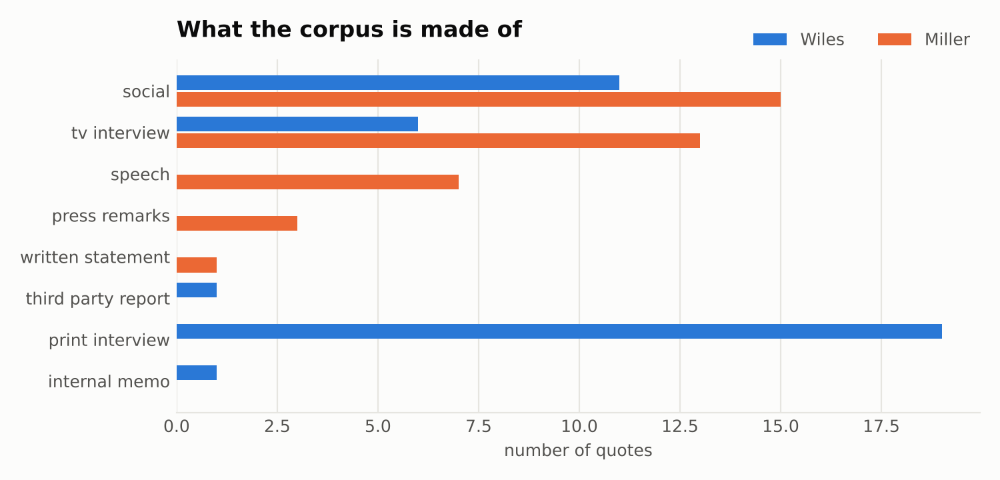
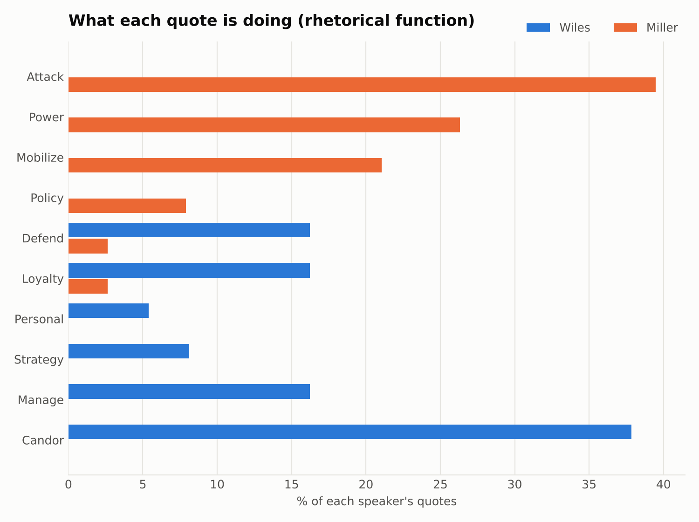
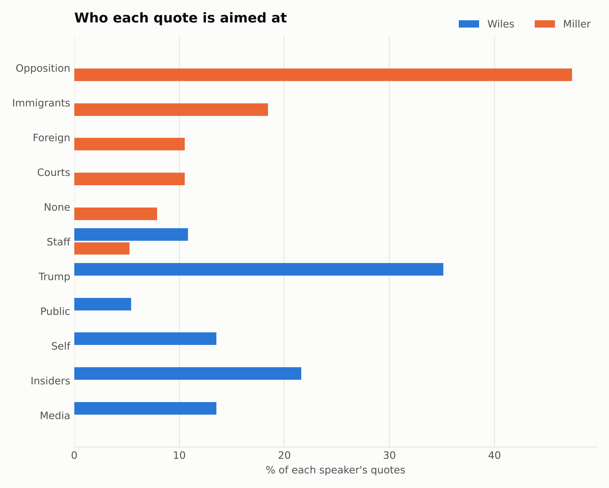
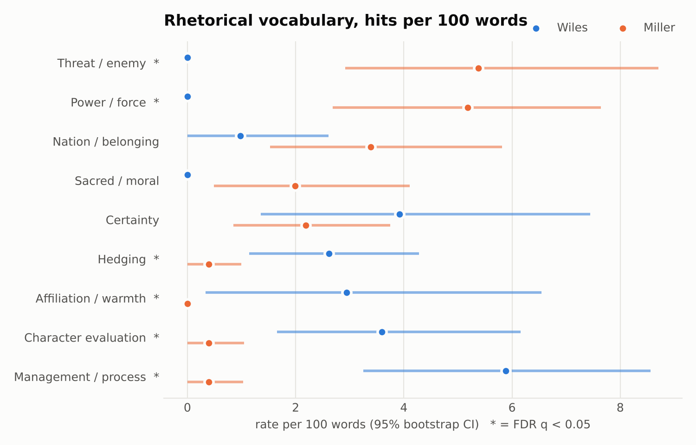
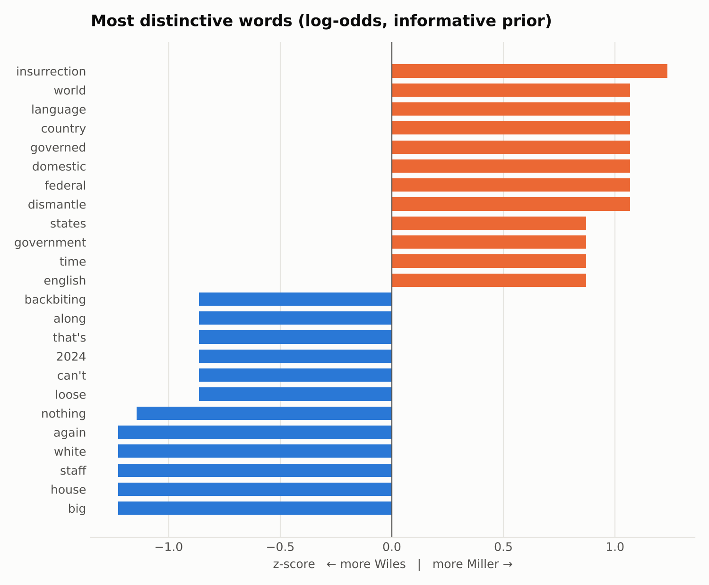
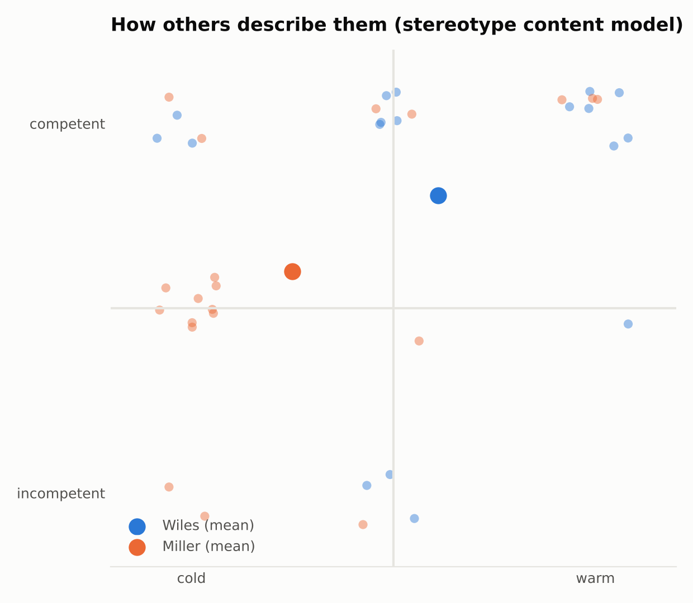

# Wiles vs. Miller: what their public words show (v1)

*Corpus: 77 quotes (38 Wiles, 39 Miller), Feb 2024 – Nov 2026, plus 38 third-party descriptions.
Read the limitations at the end before citing any number here.*

## Bottom line

**Wiles talks about the building. Miller talks about the battlefield.**

- Wiles's public words point **inward**: toward Trump, colleagues, staff and process. She manages, defends, gives credit, and (in Vanity Fair) delivers unusually blunt verdicts on insiders. In this sample she never attacks an out-group. Her only adversary is the press.
- Miller's public words point **outward**: toward the opposition, immigrants, courts and foreign governments. About 95% of his quotes attack, assert power, mobilize, or announce enforcement goals. Threat and power vocabulary run at about 5 hits per 100 words; for Wiles it is effectively zero.
- Their *surface* style is not reliably distinguishable: sentence length is similar, and a character-level authorship classifier barely beats chance. **The difference is what they say and who they say it about, not how they phrase it.**
- Others see them differently too. Neutral reporters describe Wiles as competent and low-key, and Miller as cold and dominant. Allies describe both as loyal and effective.

## 1. What the corpus is made of

The two records are lopsided, and that is itself a finding. Half of Wiles's quotes come from print interviews, and 15 of those 38 come from a single venue (Vanity Fair, Dec 2025). Miller's come from social posts, Fox/CNN hits and speeches, with no single venue dominating. Wiles also has more fragments (21 of 38) because the press quotes her in short phrases. Miller is quoted in full sentences more often (23 of 39).

## 2. What each quote is doing

| Function | Wiles | Miller |
|---|---|---|
| Attack / Power / Mobilize / Policy | **0%** | **95%** |
| Candor (evaluating insiders or Trump) | 38% | 0% |
| Loyalty, Defend, Manage | 49% | 5% |
| Strategy, Personal | 14% | 0% |

**Robustness check:** with Vanity Fair removed, Wiles's mix becomes Manage 28%, Loyalty 28%, Defend 17%, Strategy 17%, Personal 11%. The "candor" category disappears, but there is still **no** attack or power language.

## 3. Who each quote is about

- **Miller:** opposition 47%, immigrants 18%, courts 11%, foreign states 11%. That is roughly 90% aimed at external targets.
- **Wiles:** Trump 35%, insiders 22%, media 14%, self 14%, staff 11%. That is 0% external, apart from the press.

## 4. Vocabulary

Rates per 100 words, with permutation tests and FDR correction (* = q < 0.05):

| Category | Wiles | Miller | Holds without Vanity Fair? |
|---|---|---|---|
| Threat / enemy * | 0.0 | 5.4 | yes |
| Power / force * | 0.0 | 5.2 | yes |
| Management / process * | 5.9 | 0.4 | yes (stronger) |
| Affiliation / warmth * | 2.9 | 0.0 | yes |
| Hedging * | 2.6 | 0.4 | yes |
| Character evaluation * | 3.6 | 0.4 | **no**: it comes entirely from Vanity Fair |
| Certainty | 3.9 | 2.2 | n.s. |
| Nation / belonging | 1.0 | 3.4 | n.s. (q = .12) |
| Sacred / moral | 0.0 | 2.0 | n.s. (q = .10) |

Wiles hedges more ("I think," "sort of," "might") but is **not** less certain. She can be flatly categorical ("To be crystal clear, I am not going anywhere"). Her certainty is about *her own position*. Miller's certainty is about *the world* ("the iron laws of the world since the beginning of time").

## 5. Voice and pronouns (complete sentences only)

| per 100 words | Wiles | Miller |
|---|---|---|
| I / me / my | **7.0** | 0.8 (q = .02) |
| he / him (usually Trump) | 3.2 | 0.5 (q = .06) |
| we / us / our | 2.5 | 3.8 |
| you / your | 1.3 | 4.3 |
| they / them | 0.0 | 1.8 |
| words per sentence | 11.3 | 10.3 |
| average tone (VADER) | 0.01 | −0.11 |

Wiles speaks as **an individual reporting on a principal** ("I think he's a better leader now"). Miller speaks as **a movement addressing an enemy**: collective "we," second-person "you" aimed at opponents ("You are nothing"), and a "they" out-group.

**Authorship test:** a leave-one-out classifier on character n-grams scored a balanced accuracy of 0.56, against a shuffled-label 95th percentile of 0.60 (p = 0.11). With this little data, their phrasing alone does not give them away. Their content does.

## 6. Distinctive words

Miller's most distinctive words are *insurrection, governed, dismantle, domestic, federal, country, language, world*. Wiles's are *staff, White House, big, again, nothing*. The effects are small (|z| ≤ 1.2) because the corpus is small, so treat this chart as illustration, not evidence.

## 7. How others describe them

| Mean score (−1…+1) | Warmth | Competence | Dominance |
|---|---|---|---|
| Wiles, all sources | +0.22 | +0.61 | 0.00 |
| Miller, all sources | −0.50 | +0.20 | +0.65 |
| Wiles, neutral reporters | 0.00 | +0.67 | −0.17 |
| Miller, neutral reporters | −0.67 | +0.33 | +0.78 |
| Wiles, critics | −0.25 | 0.00 | 0.00 |
| Miller, critics | −0.86 | −0.29 | +0.86 |

Allies praise both as loyal and effective. The split shows up among neutral reporters and critics. Wiles reads as a **feared but quiet operator** ("gets results without leaving a trace," "Ice Maiden"). Miller reads as a **dominant ideologue** ("true believer," "wartime general," "bombastic style and zero-sum worldview"). Criticism of Wiles is mild and mostly about effectiveness ("drained," "hanging yourself with your own words"). Criticism of Miller is severe and about character.

## 8. What this suggests about Miller as Chief of Staff (hypotheses to track)

A traditional chief of staff is an inward-facing gatekeeper. Wiles's record fits that model closely, including her own on-record claims to have acted as a brake: the "loose agreement" to end score-settling within 90 days, the doubts about violent-J6 pardons, the "mighty big disagreement" on tariffs. Miller's record shows no gatekeeper register at all. That leads to hypotheses we can test once he takes over on Nov 9:

1. **H1: more public-facing.** The chief of staff's public output will rise sharply in volume. *Measure:* posts and TV hits per week.
2. **H2: the register persists.** The ATTACK/POWER share of Miller's output stays above 80% after Nov 9, rather than shifting toward MANAGE/LOYALTY. *Measure:* the codebook, interrupted time series.
3. **H3: fewer brake signals.** Fewer on-record or leaked signs of internal dissent attributed to the CoS office. *Measure:* L2 quotes coded "restraint."
4. **H4: inside and outside align.** Leaks about how the White House runs internally will match its public messaging more closely. Under Wiles, the leaked memos (process, discipline) and the public messaging (attack) were split between people.

## Limitations (important)

- **Small sample and press-filtered.** Nearly everything here is what journalists chose to quote. That favors Miller's most combative lines and Wiles's most candid ones. In part, this measures their *mediated personas*.
- **Unverified wording.** Quotes were collected from search summaries, because direct page access was blocked in the build environment. Every record has a `source_url` and should be checked before citing.
- **Single coder, and lexicons partly fit to the data.** The function, target and perception codes come from one AI coder, and some lexicon terms were chosen after reading the corpus. The lexicon contrasts are directionally clear but their size is inflated. The function/target results rest on the same single-coder caveat.
- **Channels don't match.** Miller's sample includes rallies; Wiles's has none. Wiles's sample includes long print profiles; Miller's has none.

See `docs/METHODOLOGY.md` for the full v2 design that fixes each of these.
