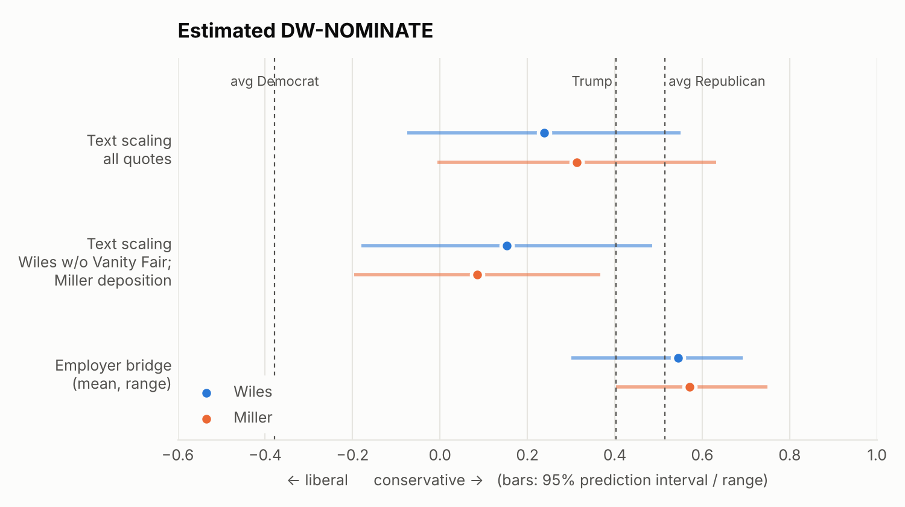

# Wiles vs. Miller: what their public words show (v2)

*Corpus: 99 attributed quotes (55 Wiles, 44 Miller), 43 third-party descriptions, and Miller's
full Jan. 6 Committee deposition (450 answers, ~26,000 words). Coverage runs from 2018 to Nov 6, 2026.
Read "Data access and limitations" before citing numbers.*

## Bottom line

1. **On left–right ideology they look the same.** Every method places both of them on the DW-NOMINATE scale at roughly mainstream-Republican level, between Trump (+0.40) and the average congressional Republican (+0.51). The employer bridge gives Wiles +0.55 and Miller +0.57; text scaling gives Wiles +0.24 and Miller +0.31, with overlapping intervals. **No method can tell them apart.**
2. **On communication role they barely overlap.** Wiles's quotes point *inward*: at Trump, colleagues, staff and process. Miller's point *outward*: at opponents, immigrants, courts and foreign states. In this sample, 95% of Miller's quotes attack, assert power, mobilize, or announce enforcement goals. None of Wiles's do.
3. **Part of that gap is the stage, not just the person.** Under oath, Miller talks a lot like Wiles: first-person, hedged, with no threat language. But where the two spoke at the *same* event (the Charlie Kirk memorial), Wiles gave credit ("That was Charlie's army") and Miller attacked ("You are nothing"). The difference is how each uses public platforms, not a fixed verbal tic.

What separates them, then, is **a combative register versus a managerial one, not a left–right position**. DW-NOMINATE is built to measure left–right position, so it is the wrong instrument for the difference that matters here.

---

## 1. Estimated DW-NOMINATE

DW-NOMINATE scores members of Congress from their roll-call votes. **Neither Wiles nor Miller has ever cast one**, so neither has a true score. These are estimates on that scale, built three ways:

| Method | Wiles | Miller | What it measures |
|---|---|---|---|
| **Employer bridge** (mean of principals' scores) | **+0.55** (range 0.30–0.69) | **+0.57** (range 0.40–0.75) | The ideology of the politicians each chose to work for |
| …post-2009 principals only | +0.58 | +0.57 | Excludes Wiles's 1979–80 jobs with Kemp and Reagan |
| **Text scaling**: all quotes | +0.24 (95% PI −0.08 to 0.55) | +0.31 (95% PI −0.01 to 0.63) | How much their words resemble Republican vs. Democratic legislators' tweets |
| Text scaling: Wiles without Vanity Fair / Miller deposition | +0.15 | +0.09 | Same model, different subsets |
| *Reference: Trump (Voteview presidential score)* | +0.40 | +0.40 | |
| *Reference: avg Republican / Democrat in Congress, 118th* | +0.51 / −0.38 | | |

**Principals used for the employer bridge:**
- **Miller:** Rep. Bachmann (+0.58), Rep. Shadegg (+0.75), Sen. Sessions (+0.55), Trump (+0.40).
- **Wiles:** Rep. Kemp (+0.30), Reagan (+0.69), Rick Scott (+0.67, from his later Senate record), DeSantis (+0.66, from his House record), Trump (+0.40).

**How the text model was built and checked.** It is a ridge regression on word and phrase features, trained on 81,365 tweets from 395 legislators in the 117th and 118th Congresses. It was tested out of sample: the model never saw a legislator's tweets during training before predicting that legislator's score.
- From a legislator's full tweet set, it recovers DW-NOMINATE at r = 0.95.
- From just **26–53 tweets** (the amount of text we have for Wiles and Miller), it recovers r = 0.94 and puts 98.8% of legislators on the correct side of zero. The 95% prediction interval is about ±0.31.

**Why the text estimates read low:** the model has a known bias on this material. It learned the vocabulary of congressional tweets, and its errors show it:
- "Deport the invaders, or surrender to insurrection" scores *left*, because in 2021 "insurrection" was mostly Democratic vocabulary about Jan. 6.
- Words like "hate" and "violence" load left, even when Miller uses them to accuse the left.
- Miller's careful legal testimony scores near the center (+0.09).

In short, the model can't tell who is accusing whom, and it treats non-partisan registers (management talk, testimony) as centrist. **I'd treat the employer bridge as the better estimate and text scaling as a lower bound.** Per-quote scores are in `reports/nominate_per_quote.csv`.

## 2. What each quote is doing

| Function | Wiles (n=53) | Miller (n=41) |
|---|---|---|
| Attack / Power / Mobilize / Policy | **0%** | **95%** |
| Candor (evaluating insiders or Trump) | 42% | 0% |
| Loyalty, Defend, Manage | 42% | 5% |
| Personal, Strategy | 17% | 0% |

**Without Vanity Fair** (27 of Wiles's 55 quotes come from that one profile), her mix is Loyalty 31%, Manage 23%, Personal 19%, Strategy 15%, Defend 12%. There is still **zero** attack or power language.

## 3. Who each quote is about

- **Miller:** opposition 46%, immigrants 17%, foreign states 12%, courts 10%. That is 85% external.
- **Wiles:** Trump 36%, insiders 21%, self 15%, media 9%, staff 8%. That is 0% external, apart from the press.

## 4. Vocabulary and voice

| per 100 words | Wiles | Miller | FDR q | Holds without Vanity Fair? |
|---|---|---|---|---|
| Threat / enemy | 0.0 | 5.4 | .002 | yes |
| Power / force | 0.0 | 5.0 | .002 | yes |
| Management / process | 4.4 | 0.4 | .003 | yes (stronger) |
| Hedging | 2.0 | 0.4 | .02 | weaker (q = .14) |
| Character evaluation | 2.4 | 0.4 | .02 | **no**: it comes entirely from Vanity Fair |
| Affiliation / warmth | 2.0 | 0.0 | .06 | yes (q = .01) |
| Nation / belonging | 0.9 | 3.3 | .06 | no |
| Sacred / moral | 0.2 | 1.9 | .07 | no |
| Certainty | 3.1 | 2.3 | n.s. | |
| **"I / me / my"** (full sentences) | **7.0** | **0.8** | .002 | |
| "he / him" (usually Trump) | 2.7 | 0.5 | .12 | |
| "we" / "you" / "they" | 1.6 / 0.8 / 0.4 | 3.8 / 4.3 / 1.8 | .29 | |

Their sentence lengths are similar (11.7 vs 10.2 words), and Miller's tone is more negative (VADER +0.05 vs −0.11). A character n-gram authorship classifier now beats chance, though only barely (balanced accuracy 0.60 against a null 95th percentile of 0.59, p = 0.04).

## 5. Register check: Miller under oath versus Miller in public

| per 100 words | Miller public (515 words) | Miller deposition (26,306 words) | Wiles public |
|---|---|---|---|
| "I / me / my" | 0.6 | **6.7** | 7.0 |
| Hedging | 0.4 | **1.2** | 2.0 |
| Certainty | 2.3 | 0.7 | 3.1 |
| Threat / enemy | 5.4 | **0.0** | 0.0 |
| Power / force | 5.0 | **0.0** | 0.0 |
| "we" | 3.1 | 0.7 | 1.6 |
| Negation | 1.0 | 3.0 | 1.9 |

In a setting where he is legally accountable and not performing for an audience, Miller's pronoun and stance profile sits much closer to Wiles's. This is the strongest caveat on the comparison: **much of "Miller's voice" is a register he chooses for public stages.** The Kirk memorial is the cleanest same-venue test we have:

| Kirk memorial, Sept 21, 2025 | |
|---|---|
| **Wiles** | "That was Charlie's army, and he made sure they understood what was at stake." · "the most powerful youth movement in our time" |
| **Miller** | "You are nothing. You are wickedness, you are jealousy, you are envy, you are hatred." · "You thought you could kill Charlie Kirk? You have made him immortal!" |

## 6. Distinctive words

Miller's most distinctive words are *insurrection, domestic, governed, dismantle, federal, country, language, world*. Wiles's are *White House, staff, campaign, work, doctors, cancer, again*. The effects are small (|z| ≤ 1.4), so treat this chart as illustration.

## 7. How others describe them

| Mean (−1…+1) | Warmth | Competence | Dominance |
|---|---|---|---|
| Wiles, all (n=22) | +0.27 | +0.55 | −0.05 |
| Miller, all (n=21) | −0.52 | +0.19 | +0.67 |
| Wiles, neutral reporters | 0.00 | +0.71 | −0.29 |
| Miller, neutral reporters | −0.67 | +0.33 | +0.78 |
| Wiles, critics | −0.20 | −0.20 | 0.00 |
| Miller, critics | −0.88 | −0.25 | +0.88 |

## 8. What to watch now that Miller is Chief of Staff

1. **More public-facing:** the chief of staff's public output (posts and TV appearances per week) rises sharply compared with Wiles.
2. **The register persists:** the ATTACK/POWER share of Miller's output stays above 80% after Nov 9.
3. **Fewer brake signals:** fewer on-record or leaked signs of internal restraint coming from the chief of staff's office. Wiles's signals included the 90-day limit on score-settling, "a couple of times where I've been outvoted," and tariffs being "more painful than I expected."
4. **No change in ideology:** DW-NOMINATE-type placements shouldn't move. The change is in governing style, not left–right position.

---

## Data access and limitations

**Why some sources are still missing.** This cloud session's network allowlist is empty: only package registries, GitHub, and a web-search tool can get out. Direct requests to news sites, Wikiquote, the American Presidency Project, CNN transcripts, GDELT, Voteview.com and the FEC API are all refused by the session's proxy. I asked twice to add those 20 sites (once as a new environment, once on the Default environment), and the environments service rejected both requests. To change it yourself: open the environment menu in the session's title bar, choose Edit, and add the hosts under Network access → Allowed domains, or pick a broader access level.

**What I used instead (all reachable):**
- GitHub mirrors of Voteview data (full member history plus the 118th/119th Congresses).
- `alexlitel/congresstweets` for legislators' tweets.
- `unitedstates/congress-legislators` for each legislator's Twitter handle.
- `epicfaace/jan6report` for Miller's deposition.
- `mkiser/WTFJHT`, a daily news digest that quotes coverage verbatim with links.
- About 60 targeted web searches.

**Remaining limitations:**
- **Small, press-filtered quote corpus.** Wiles is genuinely low-output; even so, her count rose from 38 to 55 quotes.
- **Wording not checked against originals.** Reported quotes came via search summaries and digests. Each one has a source URL.
- **Single coder.** One AI coder assigned the function, target and perception codes, and some lexicon terms were tuned after reading the data.
- **OCR noise.** The deposition text is OCR'd. Miller's answers were extracted by rule, so a few lines may be misassigned.
- **DW-NOMINATE is extrapolated, not measured.** Both methods borrow other people's votes: legislators' tweets for the text model, and their bosses' votes for the bridge.
