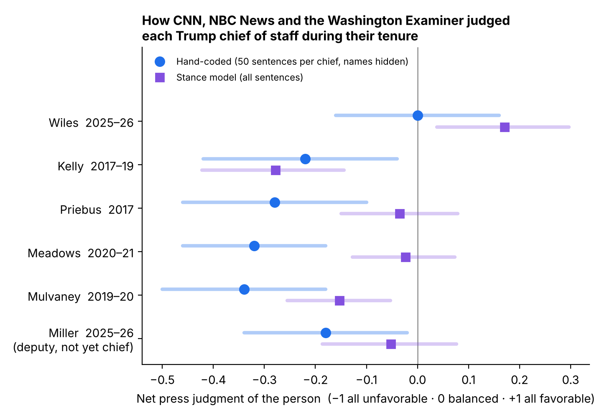

# How the press judged each Trump chief of staff

*November 8, 2026*

**Question.** Did the press judge some of Trump's chiefs of staff favorably and others unfavorably while they held the job?

**Predictions, written down before the analysis:** favorable toward Wiles and Kelly, unfavorable toward Priebus and Meadows.

**Result:** three of the four predictions hold. Kelly is the exception.

| Chief | Predicted | Hand-coded (95% range) | Stance model (95% range) | Verdict |
|---|---|---|---|---|
| Wiles | favorable | 0.00 (−0.16 to +0.16) | +0.17 (+0.04 to +0.30) | Best treated of the six; clearly favorable only on the model |
| Priebus | unfavorable | −0.28 (−0.46 to −0.10) | −0.03 (−0.15 to +0.08) | Holds on the hand-coded measure |
| Meadows | unfavorable | −0.32 (−0.46 to −0.18) | −0.02 (−0.13 to +0.07) | Holds on the hand-coded measure |
| Kelly | favorable | −0.22 (−0.42 to −0.04) | −0.28 (−0.42 to −0.14) | **Fails on both measures** |
| Mulvaney | — | −0.34 (−0.50 to −0.18) | −0.15 (−0.25 to −0.05) | Unfavorable |
| Miller (deputy) | — | −0.18 (−0.34 to −0.02) | −0.05 (−0.19 to +0.08) | Mildly unfavorable |

Scale: −1 means every sentence about the person is unfavorable, +1 every sentence favorable, 0 balanced.

**Kelly's arc** (model estimates). In his first 90 days his coverage was balanced (−0.01). In his last 90 days it was −0.53, the worst of any chief in any period. Coverage turned on the Rob Porter abuse scandal, his disputed account of Rep. Frederica Wilson in the Gold Star dispute, and repeated "on the outs with Trump" reporting. The "adult in the room" reputation was real, but it came early and didn't last. Wiles moved the other way within positive territory: +0.56 in her first 90 days, +0.03 in her last.

## What was measured

**Not story tone.** An earlier pass used GDELT's tone score, which rates the emotional language of whole articles. That measures the stories a person appears in, not the press's judgment of them. Kelly's single most negative week on that measure, for example, was the October 2017 Gold Star dispute, with about 12,700 articles. For the record, tone ranked the chiefs differently: Wiles warmest, Miller far coldest ([figure](figures/press_tone.png)).

**The press's judgment of the person.** For each sentence about a chief, did it portray that person favorably, unfavorably or neutrally?

## How

1. **Corpus.** Every article during each chief's tenure, from CNN, NBC News and the Washington Examiner, whose web address names the chief or mentions "chief of staff." Articles came from each outlet's public sitemaps, so this is a complete list, not a search-engine sample. Vox was planned but blocks downloads. A fixed outlet set keeps changes in the media mix between 2017 and 2025 out of the comparison.
2. **Inclusion.** The article names the chief in full and discusses them in at least two sentences. Result: 562 articles.
3. **Sentences.** Each sentence that names the chief, capped at 8 per article. Sentences where the chief is the speaker ("Kelly said…") are dropped: they show what the chief said, not how the press judged them. Result: 2,720 sentences.
4. **Labels.**
   - An open-source stance model (DeBERTa-v3 zero-shot) labeled every sentence as favorable, unfavorable or neutral toward the named chief.
   - Separately, Claude hand-coded 300 sentences, 50 per chief, with the name replaced by "[CHIEF]" and without seeing the model's labels.
5. **Scoring.** Net favorability is the share favorable minus the share unfavorable. Each article counts once, each chief-month counts equally so scandal weeks can't dominate, and estimates are adjusted for outlet. The 95% ranges come from resampling whole months.

## Validation, and why the hand-coded numbers lead

The model agreed with the hand codes on 62% of sentences (Cohen's kappa 0.35, fair agreement). It almost never got the direction backwards: 6 of 300 sentences. Its main error was calling negative sentences neutral, and it did this much more for Priebus and Meadows than for anyone else. Without the validation step, both would wrongly look neutral. The hand codes are therefore the primary measure; the model adds sample size and robustness checks.

## Robustness

Kelly stays unfavorable and Wiles stays the best-treated chief across every check:

| Check | Wiles | Kelly |
|---|---|---|
| Reporter's own voice only | +0.03 | −0.29 |
| News only (no opinion) | +0.17 | −0.27 |
| CNN and NBC News only | +0.16 | −0.24 |
| Washington Examiner only | +0.17 | −0.28 |

The right-leaning Examiner was as hard on Kelly as CNN and NBC were.

## Limits

- **One coder.** The hand codes come from a single coder, an AI model. A second human coder should label the same 300 sentences before anyone cites these numbers. `data/press/coder_sheet.csv` is ready for that, and `press/README.md` has instructions.
- **Thin samples for Wiles and Miller** (33 and 46 articles), so their ranges are wide.
- **One right-leaning outlet.** Fox News, the New York Post, the Washington Times and National Review either blocked access or have no dated archive.
- **Name-only matching.** Sentences that refer to the chief only as "he" or "the chief of staff" are missed.
- **Miller has not served as chief yet.** His row covers his time as deputy chief of staff.

Code: `press/`. Data: `data/press/`.
