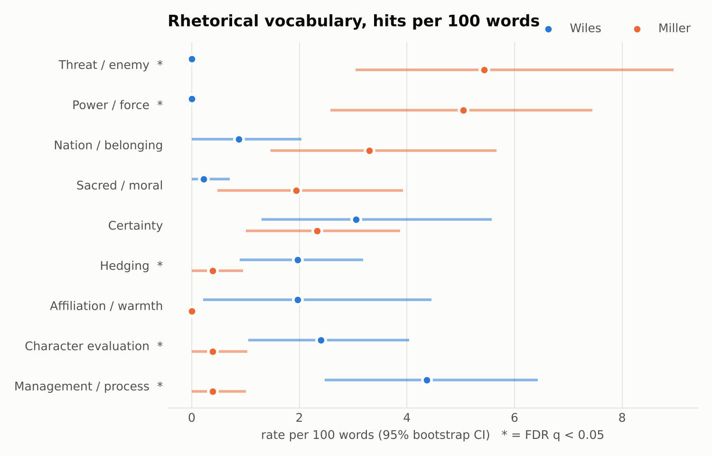
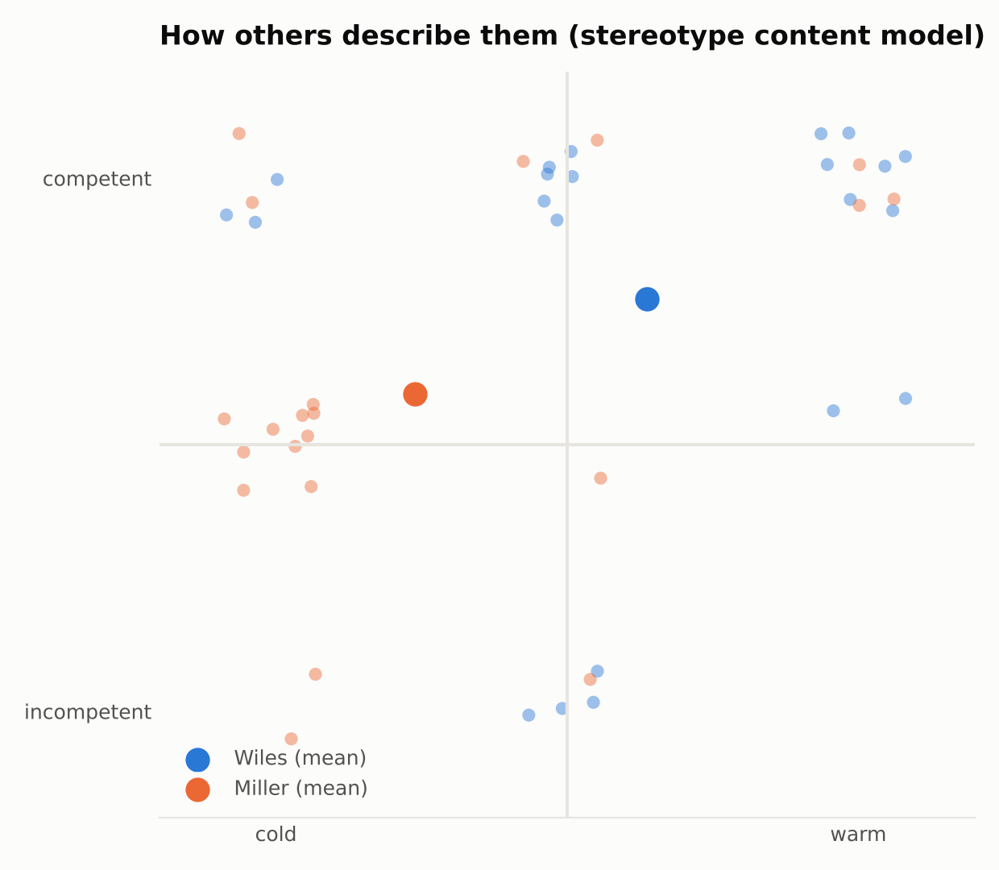
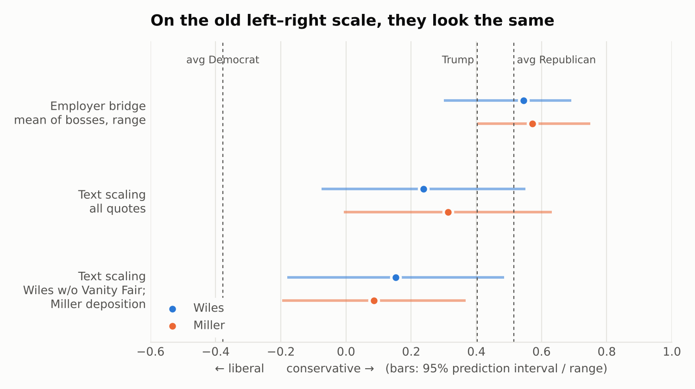
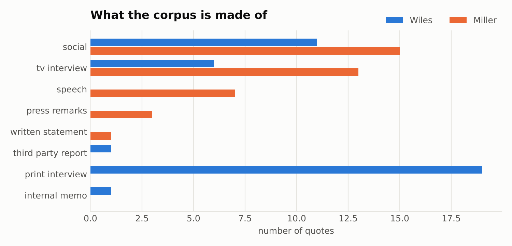

# Supporting analyses

These back up the main report, [From brake to accelerator](REPORT.md). They use the same quote dataset: 53 usable public quotes from Wiles and 41 from Miller.

## 1. Vocabulary and voice

We counted words from small, hand-built word lists, per 100 words spoken. Differences marked * survive a correction for testing many categories at once.

| per 100 words | Wiles | Miller |
|---|---|---|
| Threat words ("insurrection," "invaders," "terrorist") | 0.0 | 5.4 |
| Power words ("force," "authority," "dismantle," "deport") | 0.0 | 5.0 |
| Management words ("team," "staff," "mission," "tolerate") | 4.4 | 0.4 |
| "I / me / my" | 7.0 | 0.8 |

Wiles speaks as an individual reporting on her boss. Miller speaks as "we" against "you" and "they." Caution: some words were added to the lists after reading the quotes, which makes these gaps look larger than they are.

## 2. Miller under oath

Miller's 2022 deposition to the House Jan. 6 Committee (450 answers, about 26,000 words) shows how he talks when he isn't performing for an audience:

| per 100 words | Miller in public | Miller under oath | Wiles in public |
|---|---|---|---|
| "I / me / my" | 0.6 | 6.7 | 7.0 |
| Hedging ("I think," "might," "probably") | 0.4 | 1.2 | 2.0 |
| Threat and power words | 10.4 | 0.0 | 0.0 |

Under oath he sounds much more like Wiles. His public voice is a choice of register, not the only way he talks.

## 3. How others describe them

We collected 43 descriptions of the two by others (allies, critics and news reporters) and scored each for warmth, competence and dominance.
- **Allies** describe both as loyal and effective.
- **News reporters** describe Wiles as competent and low-key ("gets results without leaving a trace"), and Miller as cold and dominant ("wartime general," "bombastic style and zero-sum worldview").
- **Critics'** descriptions of Wiles are mild; their descriptions of Miller are severe.

## 4. Why standard left–right ideology scores can't separate them

Political scientists place members of Congress on a left–right scale (DW-NOMINATE, −1 liberal to +1 conservative) using their roll-call votes. Neither Wiles nor Miller has voted in Congress, so we estimated their positions two ways:
- **From their bosses:** the average score of the politicians each worked for. Wiles comes out at +0.55 (Kemp, Reagan, Rick Scott, DeSantis, Trump). Miller comes out at +0.57 (Bachmann, Shadegg, Sessions, Trump).
- **From their words:** a model trained on 81,000 tweets by members of Congress.

Both methods put them in the same place. **That doesn't mean they hold the same views.** The scale measures the old divide over taxes, spending and the size of government. It barely registers immigration, trade, nationalism or executive power, which are the issues where Miller stands out. The same blind spot explains why Trump himself scores *less* conservative (+0.40) than the average congressional Republican (+0.51).

The word-based model has a further problem: it learned 2021 congressional vocabulary, so it scores "Deport the invaders, or surrender to insurrection" as liberal, because Democrats used "insurrection" about Jan. 6. These scores are included for completeness only.

## 5. What the dataset contains

Wiles's quotes come mostly from print interviews (27 from one Vanity Fair series) and short posts on X. Miller's come from TV interviews, X posts and speeches. The main report's conclusions about Wiles lean heavily on the Vanity Fair interviews, and it says so.
